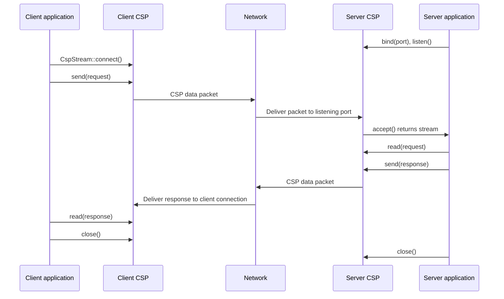
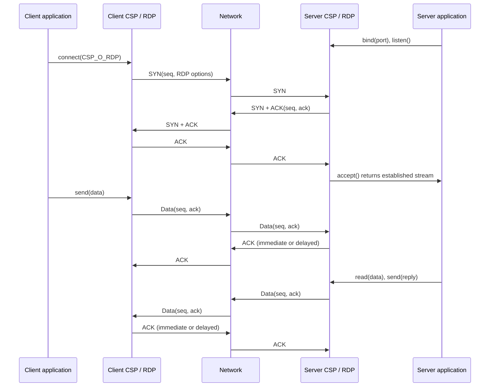
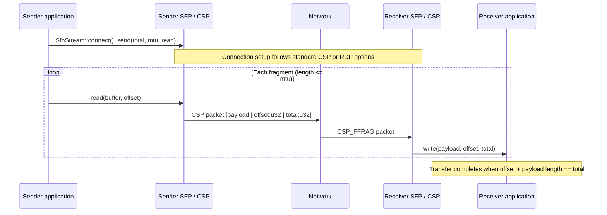

# libcsp-rs

upto origin libcsp commit 5ba0ccf

Enable the optional `defmt` Cargo feature to emit packet-routing, bridge, and RDP
diagnostics through `defmt`. The `embassy` feature enables `defmt` automatically.

## Connection and transfer flows

### Standard connection

A standard `CspStream` connection is local connection state, not a wire-level
handshake. The listener accepts the connection when the first client packet
arrives; the application sends and receives CSP packets over the resulting
connection.



### RDP connection

With `ConnOptions::CSP_O_RDP`, CSP establishes the connection on the wire using
the RDP SYN/SYN-ACK/ACK exchange. Data segments use sequence and acknowledgment
numbers; the router's regular timeout work handles retransmission and delayed
ACKs.



### SFP transfer

`SfpStream` runs on a CSP connection and splits a transfer into packets no
larger than the selected MTU. Each fragment carries its payload followed by
its big-endian byte offset and total transfer size. The receiver validates the
sequence of fragments and calls the write callback with the payload, offset,
and total size. Enabling RDP adds reliable delivery beneath SFP.



The host-side ZeroMQ PUB/SUB interface is available with the `zmq` feature. It
connects to a hub's subscriber endpoint on TCP port 6000 for transmit and its
publisher endpoint on TCP port 7000 for receive. The interface transports one
packed CSP 2.x header and payload per single-part ZeroMQ message.

```rust,ignore
use csp::drivers::zmq::ZmqDriver;
use csp::interfaces::{add_interface, zmq::ZmqInterface};
use static_cell::StaticCell;

static ZMQ_IFACE: StaticCell<ZmqInterface<ZmqDriver>> = StaticCell::new();

let driver = ZmqDriver::connect("127.0.0.1")?;
let iface = ZMQ_IFACE.init(ZmqInterface::new(1, 14, true, driver));
add_interface(iface);
```

The Embassy STM32 I2C interface is available with `embassy_stm32`. Initialize an
async master peripheral, a static [`I2cTxQueue`](src/drivers/i2c_embassy_stm32.rs),
and a [`I2cInterface`](src/interfaces/i2c.rs). The driver switches the peripheral
to multimaster mode so it can send controller writes and receive target writes:

```rust,ignore
use csp::drivers::embassy_stm32::{I2cStm32Driver, I2cTxQueue};
use csp::interfaces::{add_interface, i2c::I2cInterface};
use static_cell::StaticCell;

static I2C_TX: StaticCell<I2cTxQueue> = StaticCell::new();
static I2C_IFACE: StaticCell<I2cInterface<I2cStm32Driver>> = StaticCell::new();

// Configure Embassy I2C in async master mode with the board's peripheral, pins,
// DMA channels, and interrupt bindings.
let i2c_tx = I2C_TX.init(I2cTxQueue::new());
let driver = I2cStm32Driver::new(i2c, 0x42, i2c_tx, spawner.make_send());
let iface = I2C_IFACE.init(I2cInterface::new(1, 14, "I2C", true, driver));
add_interface(iface);
```

The configured seven-bit address (`0x42` above) is the local hardware target
address. Outgoing CSP next hops use the low seven bits of `via`, or the CSP
destination when no `via` address is specified. Incoming CSP frames must be sent
as controller writes containing the six-byte CSP header followed by its payload.
Target read requests are not a CSP transport operation; the driver sends a
one-byte invalid frame to release the I2C bus.

The Embassy STM32 KISS interface carries CSP packets over an asynchronous UART.
Configure the UART for the same baud rate and framing as the remote KISS TNC,
then provide static queue and interface storage:

```rust,ignore
use csp::drivers::embassy_stm32::{KissStm32Driver, KissTxQueue};
use csp::interfaces::{add_interface, kiss::KissInterface};
use static_cell::StaticCell;

static KISS_TX: StaticCell<KissTxQueue> = StaticCell::new();
static KISS_IFACE: StaticCell<KissInterface<KissStm32Driver>> = StaticCell::new();

// Configure an async Embassy UART for the board's peripheral, pins, and DMA.
let tx_queue = KISS_TX.init(KissTxQueue::new());
let driver = KissStm32Driver::new(uart, tx_queue, spawner.make_send());
let iface = KISS_IFACE.init(KissInterface::new(1, 14, "KISS", true, driver));
add_interface(iface);
```

KISS frames use command `0x00` (TNC data), escape `0xC0` and `0xDB` according
to the KISS wire format, and contain a packed six-byte CSP header followed by
the packet payload. CRC32 behavior is controlled by the CSP packet flags and
handled by the CSP router.